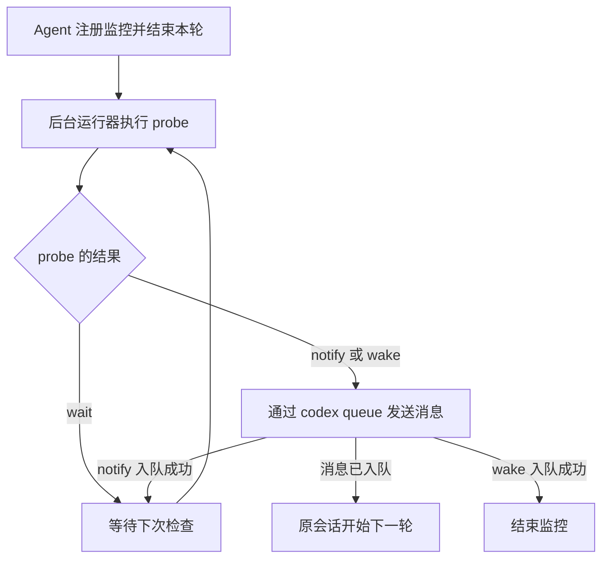

# Agent Wakeup

## 动机

Agent 完成一项工作时，常常需要等待外部任务或资源。例如，模型转换可能持续几个小时，训练可能持续几天；相关产物和结果准备好后，Agent 才能继续下载、分析或更新配置。等待期间，下一步往往已经明确，缺少的只是继续执行的时机。

让 Agent 反复查询进度，会在等待中持续消耗模型 token。结束当前轮次可以停下这些调用，但外部条件满足后，还需要有人回来提醒 Agent 继续。

等待过程中也可能出现需要 Agent 介入的时机。例如，定期结合日志判断训练是否正常，或者在某个阶段结束后提前分析实验结果。这些工作可以与后续训练并行进行，因此，有些情况下，一次唤醒之后，后台监控仍有继续运行的必要。

agent-wakeup 将这段等待交给普通的后台进程，并在需要继续工作时自动唤醒原会话。它适合这样的工作：**已经知道下一步要做什么，但必须先（长时间）等待一个能够用脚本判断的条件。** 这个条件可以是任务成功或失败、文件已经生成，或者远端服务进入指定状态。

## 工作原理

Agent 把判断条件写成一个 <u>probe</u>，也就是执行一次状态检查的脚本。每次运行后，probe 告诉运行器是继续等待，还是唤醒会话。如果需要唤醒，probe 会提供一段消息，告知 Agent 检查结果以及接下来要做的工作，并决定通知后继续检查还是结束监控。

项目中的后台运行器负责按间隔执行 probe。运行器由 Linux 的 <u>systemd</u> 用户服务管理，因此 Agent 可以在注册监控后结束当前轮次。等待期间的轮询由这些普通进程完成，无需调用模型。

当前版本通过 `codex queue` 向 Codex 会话发送消息。注册监控时会保存目标会话及其 Codex 运行环境；条件满足后，运行器把 probe 提供的消息发送到这个会话。目标 Codex 服务需要保持运行，原会话需要保持加载，这样消息到达后就能自动开始下一轮。



对于中间通知 `notify`，消息入队后监控继续运行，Agent 的处理与后台检查可以并行。对于最终唤醒 `wake`，消息入队后监控结束，服务实例自动禁用。监控记录和投递结果会保留，便于之后查看或清理。

需要进一步了解各模块的职责、会话绑定和后台运行过程时，可阅读[架构与运行流程](doc/architecture.md)。

## 使用方法

使用本地项目目录中的 `agent-wakeup` 入口脚本。各命令的用途见本地入口脚本的 `--help`；执行 `<命令> --help` 可以查看详细说明和示例。

### 编写 probe

例如，用户希望等待 `/data/report.json` 生成，然后让 Agent 读取并解释报告。可以将下面的脚本保存为 `probe.py`：

```python
import json
from pathlib import Path

if Path("/data/report.json").is_file():
    result = {
        "state": "wake",
        "summary": "报告已生成。请读取 /data/report.json 并解释结果。",
    }
else:
    result = {"state": "wait", "summary": "等待报告生成。"}

print(json.dumps(result, ensure_ascii=False))
```

输出格式由 [JSON Schema](src/agent_wakeup/schema.json) 定义，`state` 有三种选择：

| `state` | 作用 |
| --- | --- |
| `wait` | 保存检查结果，等待下一次检查。 |
| `notify` | 发送消息，成功入队后继续监控。 |
| `wake` | 发送消息，成功入队后结束监控。 |

运行器会将 `notify` 和 `wake` 的 `summary` 原样作为 prompt 发送给 Agent，因此应在其中写清结果位置、必要的背景和后续指令。较长的日志可以通过文件路径引用。

脚本每次执行只检查一次条件，检查间隔由运行器安排。正常返回使用退出码 `0`，stdout 输出一个 JSON 对象，诊断信息写入 stderr。

### 注册监控

在目标 Codex 会话中调用本地入口脚本，将示例路径替换为实际路径：

```bash
/path/to/agent-wakeup/agent-wakeup register \
  --key report-ready \
  --probe /path/to/probe.py
```

`--key` 为这项监控指定一个便于识别的名称。`register` 默认绑定当前 `CODEX_THREAD_ID` 指定的会话，也可以用 `--thread_id` 指定另一个会话。首次注册会自动生成所需的 systemd 用户服务配置，并保存 probe 的副本用于后续检查。

按具体任务选择检查间隔、总等待期限和单次检查超时。参数的作用、默认值和调用示例见 `agent-wakeup register --help`。

### 结束本轮，等待继续

注册成功后，向用户报告返回的监控 ID，然后结束当前轮次。后台运行器会接管等待，条件满足后发送消息。收到消息时，根据其中的结果和指令继续原来的工作。

需要查看进展时，用 `list` 找到监控 ID，再用 `status` 查看详细记录。需要提前结束等待时，用 `cancel` 停止监控。监控结束后，可以用 `remove` 清理保存的记录。
