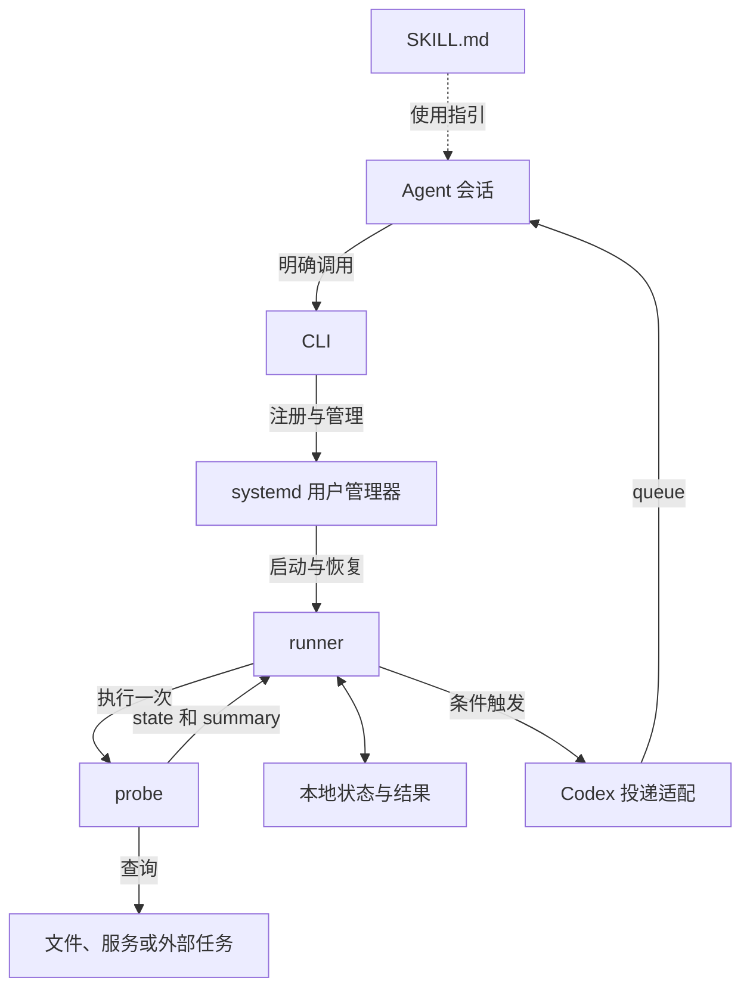
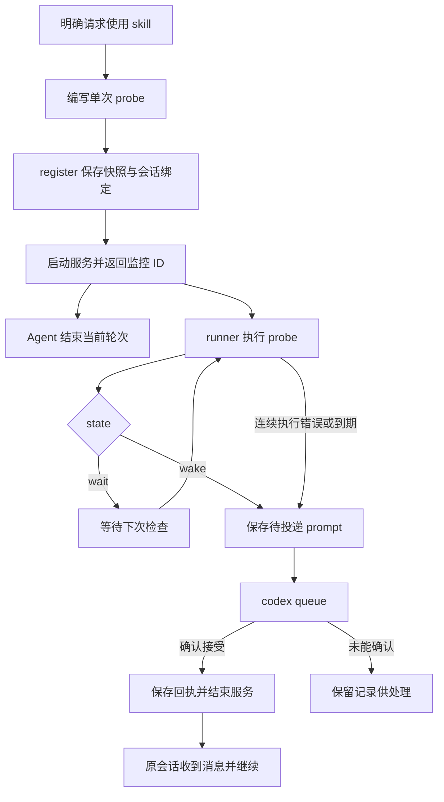

# Agent Wakeup

当后续工作需要等待外部条件时，将条件检查交给后台进程。Agent 注册监控后结束当前轮次，条件满足时由后台消息唤醒原会话，继续后续工作。等待期间的轮询无需调用模型。

项目同时提供 skill 和命令行工具。当前使用 Linux <u>systemd</u> 用户服务托管监控，通过 `codex queue` 投递消息。

## 基础用法

需要 [uv](https://docs.astral.sh/uv/getting-started/installation/)、可用的 systemd 用户服务，以及支持 `queue` 的 Codex CLI。Python 和项目依赖由 uv 管理。

将项目放在所需的 skill 目录中，通过目录内的入口脚本调用：

```bash
git clone https://github.com/HAL-42/agent-wakeup.git
cd agent-wakeup
./agent-wakeup --help
```

用户提供需要等待的条件和触发后的工作，例如：

> 使用 agent-wakeup 等待 `/data/report.json` 生成，随后读取报告并解释结果。

### 编写 probe

<u>Probe</u> 是每次执行只检查一次条件的脚本，输出遵循 [JSON Schema](src/agent_wakeup/schema.json)。触发时，`summary` 会原样作为 prompt 发给 agent；将结果位置、必要的背景和后续指令写在其中，较长日志可引用文件路径。

正常返回使用退出码 `0`，stdout 输出一个 JSON 对象，诊断写 stderr。例如：

```python
import json
from pathlib import Path

ready = Path("/data/report.json").is_file()
print(
    json.dumps(
        {
            "state": "wake" if ready else "wait",
            "summary": "报告已生成，请读取 /data/report.json 并解释结果。"
            if ready
            else "等待报告生成",
        },
        ensure_ascii=False,
    )
)
```

### 注册并继续

将脚本保存为 `probe.py`，在目标 Codex 会话中注册：

```bash
/absolute/path/agent-wakeup/agent-wakeup register \
  --key report-ready --probe /absolute/path/probe.py
```

`register` 保存 probe 快照并绑定目标会话，默认取当前 `CODEX_THREAD_ID`，也可指定会话 UUID。首次注册自动生成所需的用户服务配置。

注册成功后，向用户报告监控 ID 并结束当前轮次。让目标 Codex 服务保持运行、原会话保持加载；收到消息后，根据其中的结果和指令继续工作。

按任务需要选择检查间隔、期限、解释器、工作目录和环境。具体参数见 `register --help`，其他管理命令见入口脚本的 `--help`。

## 模块关系



probe 负责业务判断和组织 prompt；<u>runner</u> 是后台运行器，管理检查与投递；systemd 管理进程生命周期。其他 agent 可以通过增加投递适配接入。

## 运行流程



投递适配连接原会话所属的 Codex 环境。`queued` 表示已接受投递，后续执行发生在原会话中。

## 运行记录与服务

默认状态目录为 `${XDG_STATE_HOME:-~/.local/state}/agent-wakeup`，可用 `--state_dir` 指定。每个监控保存配置、probe 快照、最近输出和投递回执。环境覆盖保存在该用户的私有配置中。

代码和 `.venv` 保留在项目目录。systemd 模板位于用户配置目录，按项目和状态目录区分；uv 路径在注册时检测。模板字段说明见[服务模板](src/agent_wakeup/systemd.service.in)。

监控结束后 runner 退出，服务实例禁用，记录保留。通过 `status` 查看、`cancel` 停止监控、`remove` 清理已结束记录；原始脚本和外部产物由使用者管理。journal 历史由系统管理。

`delivery_unknown` 保留了无法确认的投递。核对目标会话后，可用 `retry_delivery` 重新发送保存的 prompt。该操作不会重新执行 probe。

服务使用当前用户的 systemd 管理器。项目保持已有 linger 设置；需要跨退出登录持续运行时，由使用者配置用户管理器的生命周期。

## 开发

```bash
uv run --locked pytest
uv run --locked ruff check .
```

依赖和解释器版本由仓库记录。项目采用 [Apache-2.0](LICENSE) 许可证。
