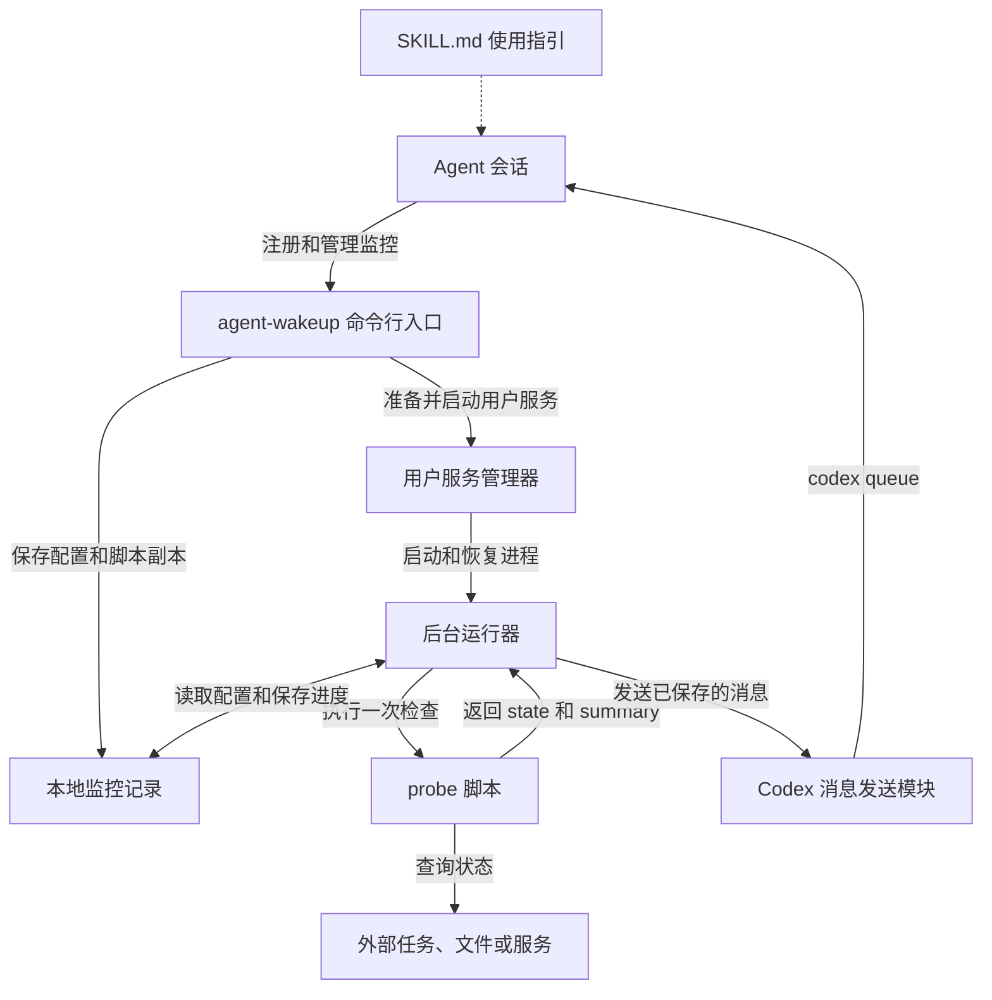
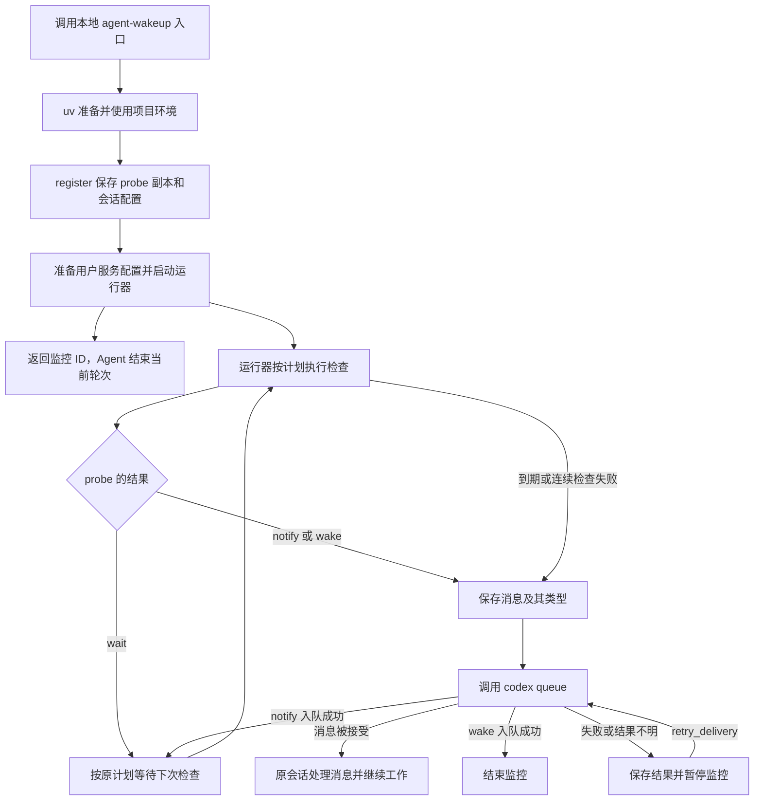

# 架构与运行流程

一次监控可以跨越 Agent 的多个轮次：初次安排等待，运行期间处理阶段结果，最后处理最终结果。这些轮次之间可能相隔几小时甚至几天，因此，检查条件、目标会话和运行进度都需要交给能够独立运行的后台进程保存和处理。

基础用法见 [SKILL.md](../SKILL.md)。本文介绍各模块如何配合，以及一项监控从注册到结束的完整过程。

## 模块关系



| 模块 | 职责 |
| --- | --- |
| 命令行入口 | 接收注册和管理请求，保存监控配置，并控制对应的用户服务。Agent 通过这个入口安排后续等待。 |
| <u>probe</u> | 执行与具体任务有关的查询，决定何时通知 Agent、是否结束监控，并组织消息。通知频率和重复提醒由脚本自己控制。 |
| 后台运行器 | 按计划执行 probe，保存检查结果，并根据脚本的返回值发送消息、继续检查或结束监控。每项监控有自己的运行器进程。 |
| 用户服务管理器 | 启动、停止监控进程，并在进程异常退出时按服务配置尝试重启。Linux 使用 <u>systemd</u>，macOS 使用 <u>launchd</u>。 |
| Codex 消息发送模块 | 使用已保存的会话信息调用 `codex queue`，并把投递回执或错误交给运行器记录。 |
| 本地监控记录 | 保存配置、probe 副本、当前进度、最近输出和投递结果。命令行工具与运行器通过这些记录共享信息。 |

用户服务管理器让监控进程独立于发起注册的命令运行。Codex 服务由原运行环境管理，原会话保持加载后，才能接收后台消息并开始下一轮。

业务判断与会话消息发送分别由 probe 和发送模块负责。扩展其他 Agent 时，可以保留 probe 协议和检查流程，补充相应的会话绑定及消息发送逻辑。

## 运行流程



### 注册与会话绑定

本地入口通过 `uv run` 使用项目环境，项目依赖保存在目录内的 `.venv` 中。`register` 会保存 probe 的副本、解释器、工作目录和环境参数，再准备对应的用户服务。运行器确认启动后，命令返回监控 ID，Agent 就可以结束当前轮次。

每个监控 ID 对应一个服务实例。Linux 中，来自同一项目和状态目录的实例共用一份 systemd 模板，实例根据自己的 ID 读取监控配置。模板所需的 uv 路径在当前机器上解析，字段说明见[模板文件](../src/agent_wakeup/systemd.service.in)。

macOS 为每项监控生成一份 `~/Library/LaunchAgents/<服务标识>.plist`，其中记录项目环境的 Python 路径、运行目录和参数。launchd 直接启动 Python 运行器，uv 在调用注册命令时负责准备环境。配置只作用于当前用户的图形登录会话。

后台发送消息需要同时知道目标会话和它所属的 Codex 环境。因此，注册时会一起保存会话 UUID、Codex 可执行文件路径、账号与数据目录，以及可选的服务器端点。后台服务的启动环境可能与交互式终端不同，这些信息让后续消息能够发回原会话所属的服务。

### 周期检查与消息生成

新注册的监控会先执行一次 probe。之后的检查间隔从上一次有效检查结束时开始计算。同一项监控的检查按顺序执行，因此某次查询较慢时，下一次检查也会相应推迟。

probe 返回 `wait` 时，运行器保存最近结果并等待下一次检查。返回 `notify` 或 `wake` 时，运行器把 `summary` 保存为待发送的消息，同时记录这次发送之后应继续检查还是结束监控。这样，即使发送需要重试，运行器也能恢复正确的后续行为。

probe 根据业务情况选择消息类型。需要 Agent 查看运行状态或处理阶段结果时，可以返回 `notify`。全部完成或发生需要结束监控的业务失败时，可以返回 `wake`，并在消息中说明后续工作。

总等待期限和连续检查错误由运行器处理。到达期限，或脚本连续执行失败达到设定次数时，运行器会生成一条用于结束监控的消息，说明原因并让 Agent 决定后续处理。相关参数及错误计数规则见 `register --help`。

### 消息发送与监控结束

运行器把已保存的消息交给发送模块，再由发送模块调用 `codex queue`。收到明确的接受回执后，运行器会把消息 ID 和后续运行状态一起保存。

对于 `notify`，监控回到 `waiting`，服务继续运行，并按原计划执行下一次检查。消息入队后即可继续检查，无需等待 Agent 处理完消息。通知不会延长总等待期限。

对于 `wake`，监控进入 `queued`，随后清理该实例的自动启动配置并退出。Linux 会禁用服务实例，macOS 会删除对应的 LaunchAgent 配置文件。用于结束监控的超时或检查错误消息也按这个流程处理，后续工作由原会话执行。

消息发送失败或结果无法确认时，运行器保留待发送消息和命令输出，暂停监控。`retry_delivery` 会先重新发送保存的消息：中间通知成功后恢复检查，最终唤醒成功后结束监控。重试继续使用原来的总等待期限，具体用法见该命令的帮助。

### 运行记录与进程恢复

运行进度保存在磁盘上，服务管理器重启运行器后，它会从已有记录继续检查或处理待发送的消息，总等待期限也沿用原值。如果进程在发送过程中退出，新运行器会把结果标记为 `delivery_unknown`，留待结合目标会话确认，避免把不明确的结果当作一次全新的发送。

取消或超时会清理正在执行的命令及其进程组。Linux 还由 systemd 清理服务内的进程；macOS 额外检测父进程退出，让运行器被强制结束时，正在执行的 probe 或消息发送命令也能得到清理。后续命令会等待这项清理完成，再使用同一组输出文件。

每项监控都有独立的记录目录，默认位于 `~/.local/state/agent-wakeup/` 下；设置了 `XDG_STATE_HOME` 时使用其中的 `agent-wakeup/`，也可通过 `--state_dir` 指定。`status` 会返回该监控的实际目录，便于查看配置、输出和投递结果。

监控结束后记录继续保留。`remove` 用于清理这些本地记录，原始 probe 脚本和外部任务产物继续由使用者管理。Linux 的共享服务模板保留供其他监控使用，journal 日志由系统管理。macOS 的运行器输出保存在监控目录的 `runner.stdout`、`runner.stderr` 中，随记录一起清理。

### macOS 的登录和休眠

关闭注册时的终端后，LaunchAgent 继续运行。注销时，系统停止用户代理，等待中的监控保留状态和启动配置；下次登录时，launchd 会重新加载它们。已完成、已取消或投递失败而暂停的监控会移除启动配置，保持原有状态。重复注册已结束的监控也只返回记录。

监控尊重系统休眠设置。休眠期间不能保证按间隔检查，恢复后继续按原计划处理；休眠时间计入总等待期限，若已经到期，就进入现有的到期通知流程。

恢复后的消息投递仍要求 Codex 服务和目标会话可用。若 Codex 尚未就绪而导致发送失败，监控会暂停，后续通过 `retry_delivery` 处理。

## 控制通知时机

每次返回 `notify` 都会请求发送一条消息。probe 可以用自己的文件记录提醒时间或已通知的阶段，让这些信息在多次脚本执行之间保留下来。

下面两个例子都假设任务有一个可写目录 `/data/run-42`，并用其中的 `finished` 文件表示任务全部完成。实际使用时，可以将文件判断替换成平台状态查询。保存提醒记录的文件应由这项监控单独使用。

### 定期请 Agent 检查运行状态

有些判断需要 Agent 结合日志完成。probe 可以在开始监控时请求一次检查，之后每隔至少一小时再次提醒。它把最近一次请求的时间写入文件，其余时间返回 `wait`。任务完成时，返回 `wake` 让 Agent 处理最终结果。

```python
import json
import time
from pathlib import Path

task_dir = Path("/data/run-42")
reminder_file = task_dir / "last-reminder.txt"
now = time.time()
last_reminder = float(reminder_file.read_text()) if reminder_file.exists() else 0.0

if (task_dir / "finished").is_file():
    result = {"state": "wake", "summary": "任务已完成，请分析 /data/run-42 的最终结果。"}
elif now - last_reminder >= 3600:
    reminder_file.write_text(str(now))
    result = {
        "state": "notify",
        "summary": "请检查 /data/run-42/train.log，判断训练是否正常。后台监控仍在运行。",
    }
else:
    result = {"state": "wait", "summary": "等待任务完成或下一次提醒。"}

print(json.dumps(result, ensure_ascii=False))
```

### 在阶段完成后通知一次

多阶段任务可以为每个完成的阶段生成一个标记文件，例如 `stage-1.done`。probe 保存已请求通知的阶段名称，发现新完成的阶段时，将它们放进一条消息。下次检查仍能看到相同标记文件时，脚本会继续等待其他阶段。

```python
import json
from pathlib import Path

task_dir = Path("/data/run-42")
record_file = task_dir / "notified-stages.json"
notified = set(json.loads(record_file.read_text())) if record_file.exists() else set()
completed = {path.stem for path in task_dir.glob("stage-*.done")}
new_stages = sorted(completed - notified)

if (task_dir / "finished").is_file():
    result = {
        "state": "wake",
        "summary": "全部阶段已完成，请分析并汇总 /data/run-42 的各阶段结果。",
    }
elif new_stages:
    record_file.write_text(json.dumps(sorted(notified | set(new_stages))))
    result = {
        "state": "notify",
        "summary": f"阶段 {', '.join(new_stages)} 已完成，请分析 /data/run-42 中对应的结果。后续阶段仍在监控中。",
    }
else:
    result = {"state": "wait", "summary": "等待其他阶段完成。"}

print(json.dumps(result, ensure_ascii=False))
```

这些文件记录的是 probe 已提出的通知请求。实际发送由运行器负责；投递失败后，运行器保留原消息，供 `retry_delivery` 继续发送。
