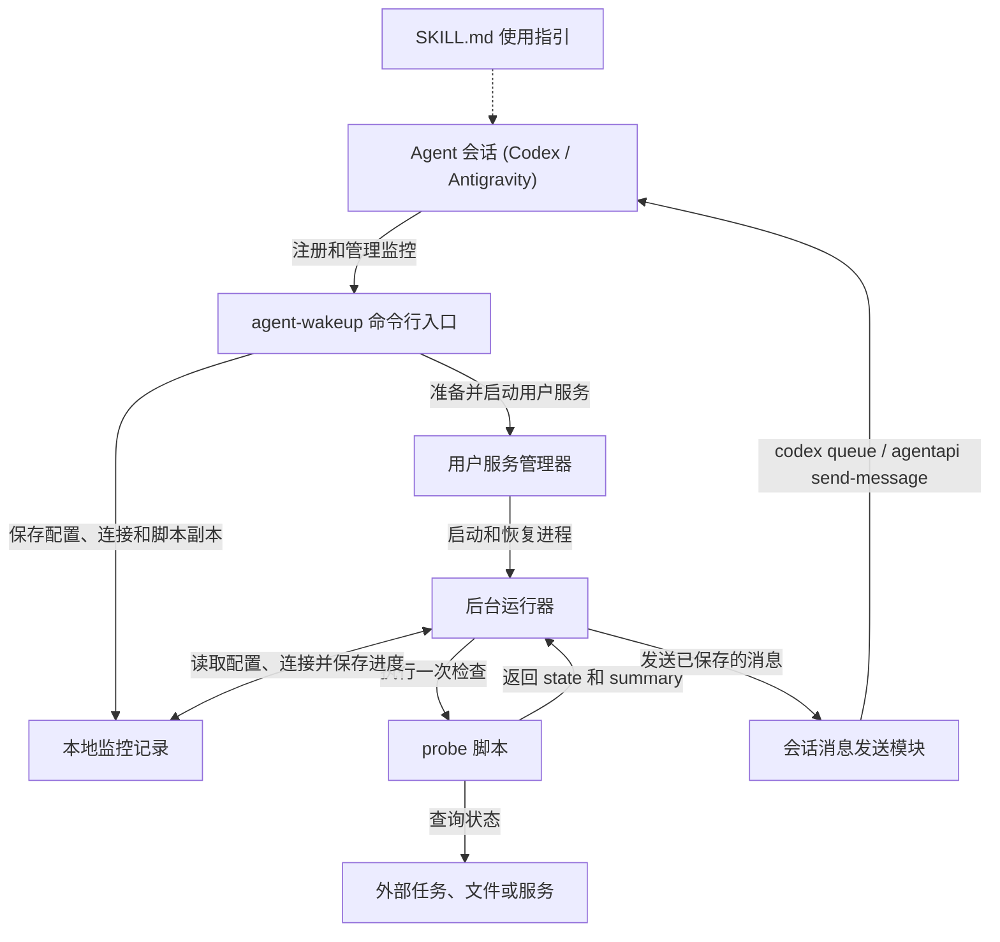
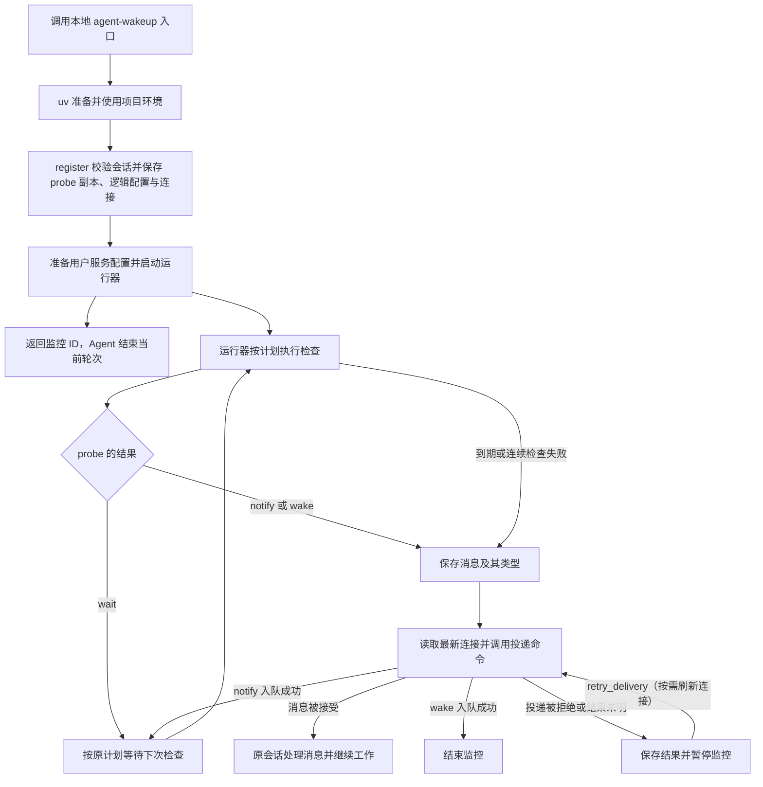

# 架构与运行流程

一次监控可以跨越 Agent 的多个轮次：初次安排等待，运行期间处理阶段结果，最后处理最终结果。这些轮次之间可能相隔几小时甚至几天，因此，检查条件、目标会话和运行进度都需要交给能够独立运行的后台进程保存和处理。

基础用法见 [SKILL.md](../SKILL.md)。本文介绍各模块如何配合，以及一项监控从注册到结束的完整过程。

## 模块关系



| 模块 | 职责 |
| --- | --- |
| 命令行入口 | 接收注册、查询、连接重绑和重发请求，保存监控配置，并控制对应的用户服务。 |
| *probe* | 执行与具体任务有关的查询，决定何时通知 Agent、是否结束监控，并组织消息。通知频率和重复提醒由脚本自己控制。 |
| 后台运行器 | 按计划执行 probe，保存检查结果，并根据脚本的返回值发送消息、继续检查或结束监控。每项监控有自己的运行器进程。 |
| 用户服务管理器 | 启动、停止监控进程，并在进程异常退出时按服务配置尝试重启。Linux 使用 *systemd*，macOS 使用 *launchd*。 |
| 会话消息发送模块 | 识别 *Codex* 与 *Antigravity* 会话环境，校验目标会话可达性，调用对应投递命令，并将回执分类交给运行器记录。 |
| 本地监控记录 | 分别保存不可变逻辑配置（`config.json`）、可变投递连接（`connection.json`）、probe 副本、运行状态（`state.json`）及最近输出。 |

用户服务管理器让监控进程独立于发起注册的命令运行。目标 Agent 服务保持运行（如远端常驻的 Antigravity `language_server` 或已加载会话的 Codex 服务）时，后台消息到达后即可自动唤醒原会话开启下一轮。

## 运行流程



### 注册与会话绑定

本地入口通过 `uv run` 使用项目环境，项目依赖保存在目录内的 `.venv` 中。`register` 保存 probe 副本、解释器、工作目录和环境参数，准备对应的用户服务并确认运行器启动后，返回监控 ID。

每个监控 ID 对应一个服务实例。Linux 中，来自同一项目和状态目录的实例共用一份 systemd 模板，字段说明见[模板文件](../src/agent_wakeup/systemd.service.in)。若服务器需要在用户断开全部登录会话后仍保持 `systemd --user` 运行，应开启 `loginctl enable-linger`（可通过 `doctor` 查看当前 `linger` 状态）。macOS 为每项监控生成一份 `~/Library/LaunchAgents/<服务标识>.plist`，直接启动项目环境中的 Python 运行器，作用于当前用户的图形登录会话。

监控的配置拆分为两部分保存（文件权限均为 `0600`）：

- `config.json` 记录不可变的逻辑配置，包括 `backend`、`session_id`、`key`、probe 摘要和检查时间参数，并据此计算 `fingerprint`。
- `connection.json` 记录可变的投递连接信息，不参与 `fingerprint` 计算，也不会注入 probe 子进程或出现在 `list`、`status` 输出中：
  - **Codex**：保存 `codex` 可执行文件路径与 `CODEX_HOME` 目录。
  - **Antigravity**：保存 `agentapi` 路径、`ANTIGRAVITY_LS_ADDRESS` 与 `ANTIGRAVITY_CSRF_TOKEN`。注册和重绑时会先调用 `agentapi get-conversation-metadata` 校验连接有效且目标会话真实存在。

这种拆分保证了当 Antigravity `language_server` 重启更换本地端口和 CSRF Token 后，同一会话使用原 `key` 重复调用 `register` 仍能复用原监控并刷新连接，而不会触发配置冲突。

### 周期检查与消息生成

新注册的监控会先执行一次 probe。之后的检查间隔从上一次有效检查结束时开始计算。同一项监控的检查按顺序执行，因此某次查询较慢时，下一次检查也会相应推迟。

probe 返回 `wait` 时，运行器保存最近结果并等待下一次检查。返回 `notify` 或 `wake` 时，运行器把 `summary` 保存为待发送的消息，同时记录这次发送之后应继续检查还是结束监控。

总等待期限和连续检查错误由运行器处理。到达期限，或脚本连续执行失败达到设定次数时，运行器会生成一条用于结束监控的消息，说明原因并让 Agent 决定后续处理。

### 消息发送、连接恢复与监控结束

每次进入发送阶段时，运行器从 `connection.json` 读取最新连接并调用对应后端命令：Codex 调用 `codex queue --thread <session_id> --message <summary>`，Antigravity 调用 `agentapi send-message -- <session_id> <summary>`。

对于 `notify`，收到明确接受回执后监控回到 `waiting`，服务继续运行并按原计划执行下一次检查，总等待期限保持不变。对于 `wake`（以及到期或连续错误通知），监控进入 `queued`，随后自动禁用该实例的启动配置并退出。

投递异常分为两类暂停状态：

- `delivery_failed`：投递命令未能启动，或服务端在入队前明确拒绝（例如连接拒绝、鉴权失效、目标会话不存在）。此时消息尚未入队，排除原因后重试不会造成重复发送。
- `delivery_unknown`：命令超时、进程异常中断或缺少可确认回执。此时消息可能已经送达，重试前应结合目标会话记录判断。

当宿主服务（如 Antigravity `language_server`）重启导致保存的端口和凭据失效时，有两种恢复方式：

- 对仍在等待（`waiting`）或尚未完成的监控，在新会话环境中执行 `rebind <watch_id>` 或 `rebind --all`。处于 `waiting` 的服务无需重启，下次触发投递时会自动读取更新后的 `connection.json`。
- 对已因连接失效停在 `delivery_failed` 或 `delivery_unknown` 的监控，在新会话环境中直接执行 `retry_delivery <watch_id>` 或 `retry_delivery --all`。命令会自动用当前环境刷新 `connection.json`，随后重启服务重发已保存的消息，再按原消息类型决定恢复检查或结束监控。

### 运行记录与进程恢复

运行进度保存在磁盘上，服务管理器重启运行器后，它会从已有记录继续检查或处理待发送的消息，总等待期限也沿用原值。如果进程在发送过程中退出，新运行器会把结果标记为 `delivery_unknown`，避免把不明确的结果当作一次全新的发送。

取消或超时会清理正在执行的命令及其进程组。Linux 由 systemd 控制组配合清理；macOS 额外检测父进程退出，让运行器被强制结束时正在执行的子进程组也能一并退出。

每项监控都有独立的记录目录，默认位于 `~/.local/state/agent-wakeup/` 下；设置了 `XDG_STATE_HOME` 时使用其中的 `agent-wakeup/`，也可通过 `--state_dir` 指定。监控结束后记录继续保留，`remove` 用于清理这些本地记录，原始 probe 脚本和外部任务产物继续由使用者管理。

### macOS 的登录和休眠

关闭注册时的终端后，LaunchAgent 继续运行。注销时，系统停止用户代理，等待中的监控保留状态和启动配置；下次登录时，launchd 会重新加载它们。已完成、已取消或投递异常而暂停的监控会移除启动配置，保持原有状态。

监控尊重系统休眠设置。休眠期间不能保证按间隔检查，恢复后继续按原计划处理；休眠时间计入总等待期限，若已经到期，就进入到期通知流程。

## 控制通知时机

每次返回 `notify` 都会请求发送一条消息。probe 可以用自己的文件记录提醒时间或已通知的阶段，让这些信息在多次脚本执行之间保留下来。

下面两个例子都假设任务有一个可写目录 `/data/run-42`，并用其中的 `finished` 文件表示任务全部完成。实际使用时，可以将文件判断替换成平台状态查询。保存提醒记录的文件应由这项监控单独使用。

### 定期请 Agent 检查运行状态

有些判断需要 Agent 结合日志完成。probe 可以在开始监控时请求一次检查，之后每隔至少一小时再次提醒。它把最近一次请求的时间写入文件，其余时间返回 `wait`。任务完成时，返回 `wake` 让 Agent 处理最终结果。

```python
import json
import time
from pathlib import Path

task_dir = Path("/data/run-42")
reminder_file = task_dir / "last-reminder.txt"
now = time.time()
last_reminder = float(reminder_file.read_text()) if reminder_file.exists() else 0.0

if (task_dir / "finished").is_file():
    result = {"state": "wake", "summary": "任务已完成，请分析 /data/run-42 的最终结果。"}
elif now - last_reminder >= 3600:
    reminder_file.write_text(str(now))
    result = {
        "state": "notify",
        "summary": "请检查 /data/run-42/train.log，判断训练是否正常。后台监控仍在运行。",
    }
else:
    result = {"state": "wait", "summary": "等待任务完成或下一次提醒。"}

print(json.dumps(result, ensure_ascii=False))
```

### 在阶段完成后通知一次

多阶段任务可以为每个完成的阶段生成一个标记文件，例如 `stage-1.done`。probe 保存已请求通知的阶段名称，发现新完成的阶段时，将它们放进一条消息。下次检查仍能看到相同标记文件时，脚本会继续等待其他阶段。

```python
import json
from pathlib import Path

task_dir = Path("/data/run-42")
record_file = task_dir / "notified-stages.json"
notified = set(json.loads(record_file.read_text())) if record_file.exists() else set()
completed = {path.stem for path in task_dir.glob("stage-*.done")}
new_stages = sorted(completed - notified)

if (task_dir / "finished").is_file():
    result = {
        "state": "wake",
        "summary": "全部阶段已完成，请分析并汇总 /data/run-42 的各阶段结果。",
    }
elif new_stages:
    record_file.write_text(json.dumps(sorted(notified | set(new_stages))))
    result = {
        "state": "notify",
        "summary": f"阶段 {', '.join(new_stages)} 已完成，请分析 /data/run-42 中对应的结果。后续阶段仍在监控中。",
    }
else:
    result = {"state": "wait", "summary": "等待其他阶段完成。"}

print(json.dumps(result, ensure_ascii=False))
```

这些文件记录的是 probe 已提出的通知请求。实际发送由运行器负责；投递失败后，运行器保留原消息，供 `retry_delivery` 继续发送。
