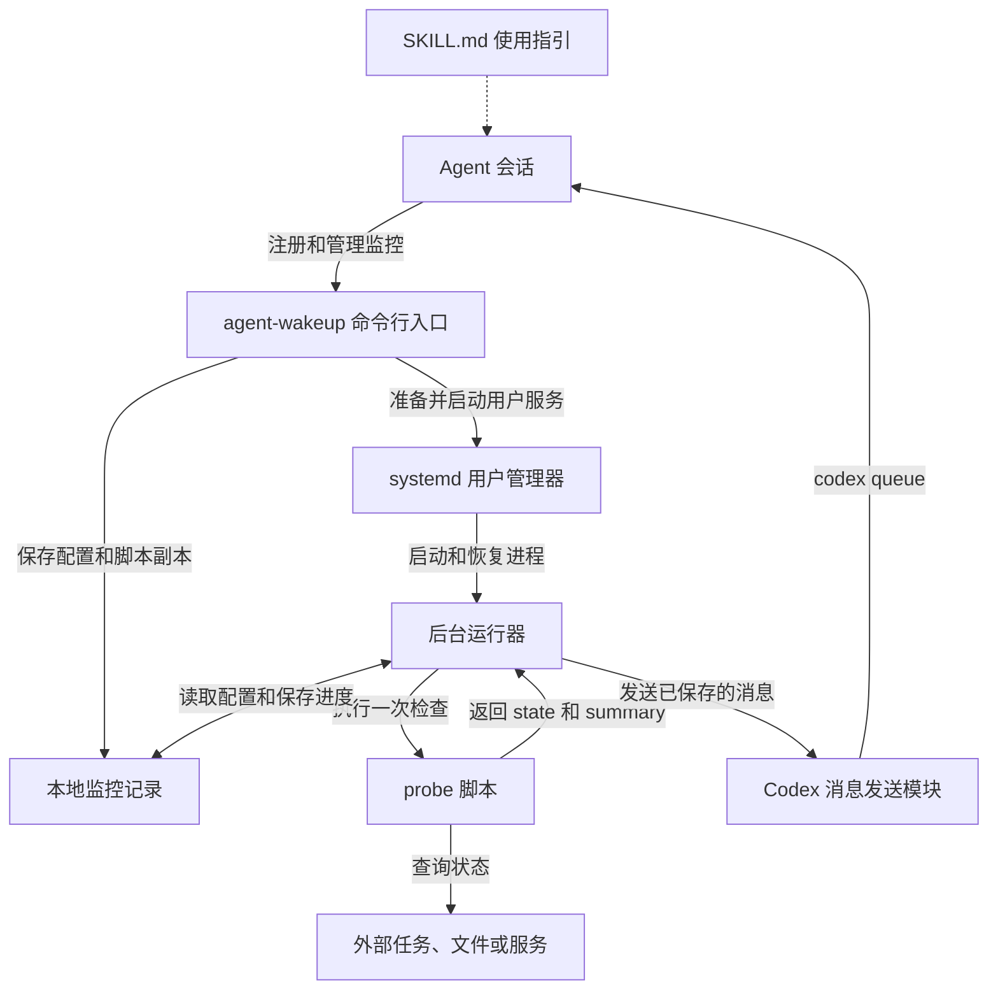
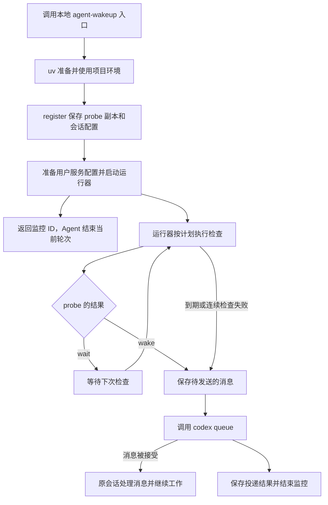

# 架构与运行流程

一次监控连接着 Agent 的两个轮次：前一个轮次安排等待，后一个轮次处理结果。两轮之间可能相隔几小时甚至几天，因此，检查条件、目标会话和运行进度都需要交给能够独立运行的后台进程保存和处理。

基础用法见 [SKILL.md](../SKILL.md)。本文介绍各模块如何配合，以及一项监控从注册到结束的完整过程。

## 模块关系

| 模块 | 职责 |
| --- | --- |
| 命令行入口 | 接收注册和管理请求，保存监控配置，并控制对应的用户服务。Agent 通过这个入口安排后续等待。 |
| <u>probe</u> | 执行与具体任务有关的查询，判断是否需要唤醒 Agent，并组织后续消息。不同业务可以使用各自的脚本。 |
| 后台运行器 | 按计划执行 probe，处理检查结果，决定何时发送消息，并保存运行进度。每项监控有自己的运行器进程。 |
| <u>systemd</u> 用户管理器 | 启动、停止监控进程，并在进程异常退出时按服务配置尝试重启。它让监控的生命周期独立于发起注册的命令。 |
| Codex 消息发送模块 | 使用已保存的会话信息调用 `codex queue`，并把投递回执或错误交给运行器记录。 |
| 本地监控记录 | 保存配置、probe 副本、当前进度、最近输出和投递结果。命令行工具与运行器通过这些记录共享信息。 |

systemd 在这里负责监控进程的生命周期，Codex 服务由原运行环境管理。原会话保持加载后，Codex 才能接收后台消息并开始下一轮。

业务判断与会话消息发送分别由 probe 和发送模块负责。扩展其他 Agent 时，可以保留 probe 协议和检查流程，补充相应的会话绑定及消息发送逻辑。

## 运行流程

### 注册与会话绑定

本地入口通过 `uv run` 使用项目环境，项目依赖保存在目录内的 `.venv` 中。`register` 会保存 probe 的副本、解释器、工作目录和环境参数，再准备对应的 systemd 用户服务。运行器确认启动后，命令返回监控 ID，Agent 就可以结束当前轮次。

每个监控 ID 对应一个服务实例。来自同一项目和状态目录的实例共用一份服务模板，实例启动时根据自己的 ID 读取监控配置。服务模板需要的 uv 路径在当前机器上解析，字段说明见[模板文件](../src/agent_wakeup/systemd.service.in)。

后台发送消息需要同时知道目标会话和它所属的 Codex 环境。因此，注册时会一起保存会话 UUID、Codex 可执行文件路径、账号与数据目录，以及可选的服务器端点。后台服务的启动环境可能与交互式终端不同，这些信息让后续消息能够发回原会话所属的服务。

### 周期检查与消息生成

新注册的监控会先执行一次 probe。之后的检查间隔从上一次有效检查结束时开始计算。同一项监控的检查按顺序执行，因此某次查询较慢时，下一次检查也会相应推迟。

probe 返回 `wait` 时，运行器保存最近结果并等待下一次检查。返回 `wake` 时，运行器把 `summary` 保存为待发送的消息，随后进入发送阶段。probe 负责解释业务结果；例如，外部任务失败时，也可以返回 `wake`，让 Agent 根据消息处理失败。

总等待期限和连续检查错误由运行器处理。到达期限，或脚本连续执行失败达到设定次数时，运行器会生成一条说明原因的消息，让 Agent 决定后续处理。相关参数及错误计数规则见 `register --help`。

### 消息发送与监控结束

运行器把已保存的消息交给发送模块，再由发送模块调用 `codex queue`。收到明确的接受回执后，运行器保存消息 ID，将监控状态记为 `queued`，然后禁用服务实例并退出。后续工作由原会话执行。

消息发送失败或结果无法确认时，运行器会保存命令输出和相应状态，结束本次监控。对于无法确认的投递，可以结合记录与目标会话判断是否需要再次发送。`retry_delivery` 使用已保存的消息和会话配置继续处理，具体适用状态见该命令的帮助。

### 运行记录与进程恢复

运行进度保存在磁盘上，systemd 重启运行器后，它会从已有记录继续检查或处理待发送的消息，总等待期限也沿用原值。如果进程在发送过程中退出，新运行器会把结果标记为 `delivery_unknown`，留待结合目标会话确认，避免把不明确的结果当作一次全新的发送。

每项监控都有独立的记录目录，默认位于 `~/.local/state/agent-wakeup/` 下；设置了 `XDG_STATE_HOME` 时使用其中的 `agent-wakeup/`，也可通过 `--state_dir` 指定。`status` 会返回该监控的实际目录，便于查看配置、输出和投递结果。

监控结束后记录继续保留。`remove` 用于清理这些本地记录，原始 probe 脚本和外部任务产物继续由使用者管理。共享的服务模板保留供其他监控使用，journal 日志由系统管理。
